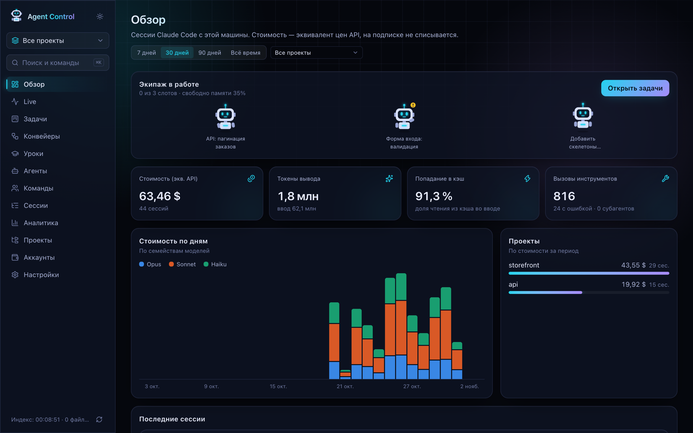
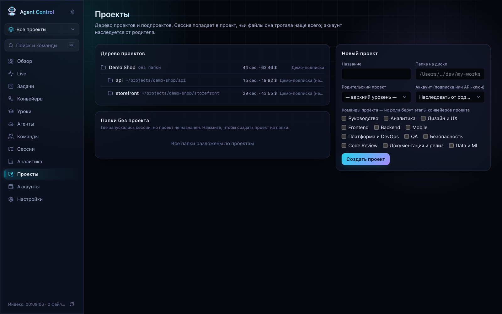
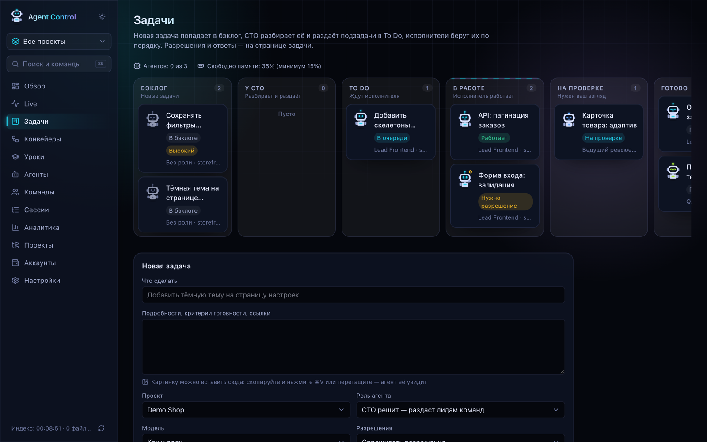
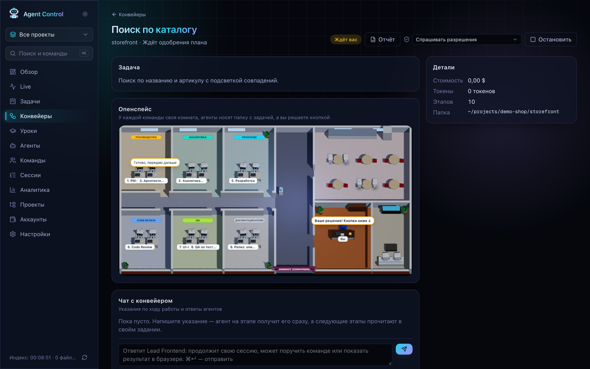
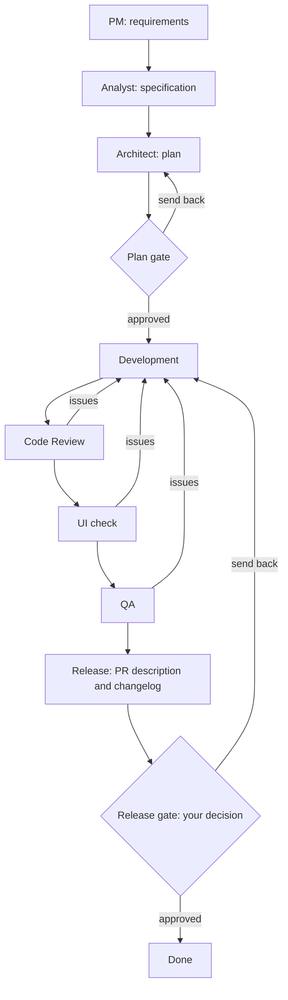
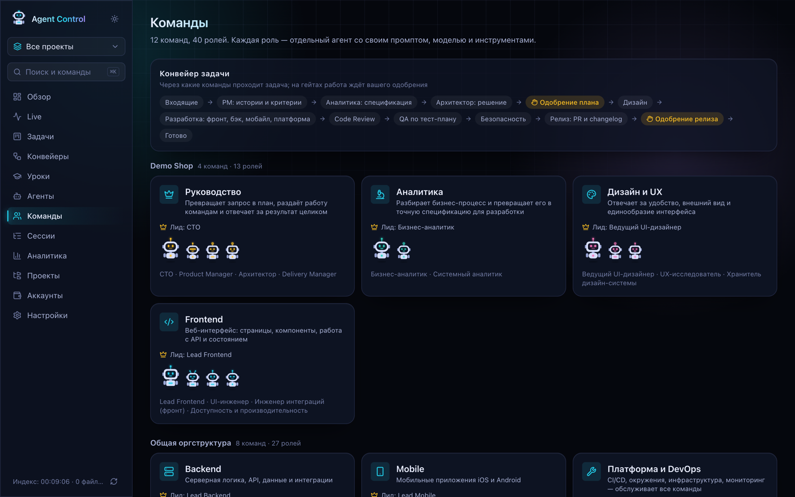
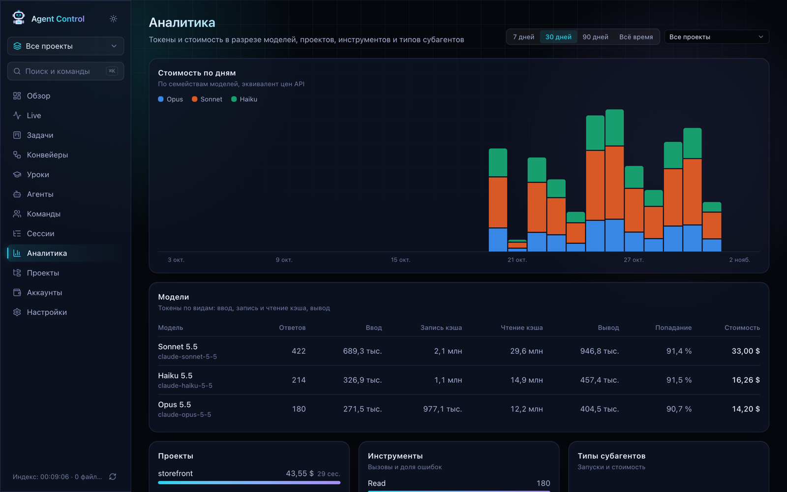

# Agent Control

[Русский](README.md) · **English** · [Oʻzbekcha](README.uz.md)

Agent Control turns Claude Code from one assistant in a terminal into a team you manage from a browser. You set a task, agents with different roles work on it in turn, and you see the whole process and make the important calls: what an agent may do, what to accept, what to release.

The app runs only on your computer. The interface is in Russian, so this guide gives Russian labels with a translation. All screenshots use the fictional project `Demo Shop`.



## Contents

1. [Why use it](#why-use-it)
2. [Key concepts](#key-concepts)
3. [Requirements](#requirements)
4. [Installation](#installation)
5. [Your first task in 10 minutes](#your-first-task-in-10-minutes)
6. [Task or pipeline](#task-or-pipeline)
7. [App sections](#app-sections)
8. [Security](#security)
9. [Where your data lives](#where-your-data-lives)
10. [Troubleshooting](#troubleshooting)
11. [Development](#development)

## Why use it

With plain Claude Code you work in one terminal session and keep everything in your head: what is done, what to check, how much was spent. Agent Control takes that over:

- it shows all sessions and spending in one place;
- it runs several agents in parallel without overloading your computer;
- it splits work by role like a real team: one plans, another writes code, a third checks;
- it keeps each task in a separate git branch, so an agent cannot break your working copy;
- it stops where your decision is needed.

## Key concepts

| Term         | In plain words                                                                                                              |
| ------------ | --------------------------------------------------------------------------------------------------------------------------- |
| **Agent**    | A running Claude Code that carries out a task.                                                                              |
| **Role**     | An agent's "job": instructions (a prompt), a model and allowed tools. For example, Lead Frontend or QA Lead.                |
| **Team**     | A group of roles with a shared focus. There are 12 teams with 40 roles out of the box. A project uses the teams you pick.   |
| **Lead**     | The main role of a team. A lead can hand parts of the work to team members.                                                 |
| **CTO**      | A special role that reads a task, splits it and hands the parts to leads.                                                   |
| **Task**     | One unit of work for one agent.                                                                                             |
| **Pipeline** | A chain of stages that one large task passes through, from requirements to release.                                         |
| **Stage**    | One step of a pipeline, carried out by an agent with the right role.                                                        |
| **Gate**     | A stopping point in a pipeline. Work continues only after approval.                                                         |
| **Board**    | The project's architect and development lead. In auto mode they decide some questions for you.                              |
| **Session**  | The record of one Claude Code conversation. This includes agent sessions and your own from the terminal.                    |
| **Worktree** | A separate copy of the repository on disk with its own branch. The agent edits files there and your folder stays untouched. |
| **Hook**     | A small command Claude Code calls on every event. It lets the app learn what is happening right away.                       |
| **Indexer**  | A background process that reads new Claude Code transcript lines every 15 seconds into the local database.                  |

## Requirements

| What                | Why                                   | How to check       |
| ------------------- | ------------------------------------- | ------------------ |
| Node.js 20.9+       | Runs the app                          | `node -v`          |
| npm                 | Installs dependencies                 | `npm -v`           |
| Git                 | Branches and worktrees for agents     | `git --version`    |
| Claude Code         | The agents themselves, signed in      | `claude --version` |
| Subscription or key | A Claude plan or an Anthropic API key | `claude`           |

If Claude Code is not installed yet:

```bash
npm install -g @anthropic-ai/claude-code
claude   # opens the sign-in
```

### Operating system

The app was written and tested on macOS. Nothing forbids other systems, but three places in the code assume macOS:

| In the code           | On macOS           | On other systems                                                      |
| --------------------- | ------------------ | --------------------------------------------------------------------- |
| API key storage       | `security` command | Does not work: accounts with an API key cannot be used                |
| Finding your `claude` | Through `/bin/zsh` | Without zsh, the copy of Claude Code bundled with the SDK is used     |
| Measuring free memory | `memory_pressure`  | Uses the system value, which can read low: lower the memory threshold |

| System         | Status                                                                            |
| -------------- | --------------------------------------------------------------------------------- |
| macOS          | Tested, everything works                                                          |
| Linux          | Not tested. Expected to work with a Claude subscription, without API key accounts |
| Windows + WSL2 | Not tested. Behaves like Linux                                                    |
| Windows        | Not tested and not recommended: hooks and paths assume a Unix environment         |

## Installation

```bash
# 1. Get the project. For a private repository, run gh auth login first
git clone https://github.com/Prouzad/agent-control.git
cd agent-control

# 2. Install dependencies
npm install

# 3. Build and start
npm run build
npm run start
```

Open <http://127.0.0.1:4400>. Keep the terminal window open: the app runs as long as it does.

The first start creates the database at `~/.agent-control/agent-control.db`, adds teams and roles, and the indexer reads your transcripts from `~/.claude`. Past sessions appear on the **Обзор** (Overview) page in about 15 seconds.

**Updating:** stop the server after checking that no tasks are running, then run `git pull && npm install && npm run build && npm run start`.

## Your first task in 10 minutes

**Step 1. Create a project.** Open **Проекты** (Projects) and fill in the name and the folder on disk. The folder must be a git repository. Tick the teams, for example Руководство (Leadership), Frontend and Code Review.



**Step 2. Install the hooks.** Open **Настройки** (Settings) and press **Установить хуки** (Install hooks). Then open a new Claude Code session: hooks only apply to new sessions.

**Step 3. Create a task.** Open **Задачи** (Tasks) and fill in **Новая задача** (New task):

- **Что сделать** (What to do): one sentence, for example "Add a dark theme to the settings page".
- **Подробности** (Details): what counts as done, links. You can paste an image right here.
- **Проект** (Project): the one from step 1.
- **Роль агента** (Agent role): for the first time pick a specific role, for example Lead Frontend.
- **Разрешения** (Permissions): Спрашивать разрешения (Ask for permission).
- **Изоляция** (Isolation): Отдельный git worktree (Separate git worktree).
- **Лимит стоимости** (Cost limit): for example `2`. The agent stops at this amount.

**Step 4. Watch the work.** Open the task. You see what the agent reads and changes. When it asks for permission, **Разрешить** (Allow) and **Отклонить** (Deny) buttons appear on the page.

**Step 5. Check the result.** When the agent finishes, the task moves to На проверке (In review). Read the report and look at the changes. Press **Принять** (Accept), or write your comments to the agent to continue. The changes stay in the task branch: moving them to your main branch is your decision.

## Task or pipeline

| Situation                                       | What to choose                                 |
| ----------------------------------------------- | ---------------------------------------------- |
| A clear small thing: fix text, add a test       | A task with a specific role                    |
| Work for several teams                          | A task with the role "CTO решит" (CTO decides) |
| A new feature with requirements, code, checks   | A pipeline, full template                      |
| The code is clear, needs development and checks | A pipeline, quick template                     |
| You need to figure things out before coding     | A pipeline, analysis-only template             |

A regular task can become a pipeline with **Запустить как конвейер** (Run as pipeline).

## App sections

### Обзор (Overview)

The home page. It shows which agents are working, free slots and memory, spending for the period and the most expensive projects. It is a good place to start the day, because you see at once who is waiting for you.

Cost is calculated from API prices. On a subscription it is an equivalent for comparison, not an actual charge.

### Live

The "agent hall": what is happening right now. For each active session you see the current tool, subagents and whether it is waiting for your answer. With hooks, events arrive instantly. Without hooks, active sessions are detected from transcript writes, with a delay.

### Задачи (Tasks)



A kanban board. A task moves from left to right:

| Column                  | What happens                                                         |
| ----------------------- | -------------------------------------------------------------------- |
| Бэклог (Backlog)        | The task is recorded but not started                                 |
| У CTO (With the CTO)    | The CTO is splitting the task                                        |
| To Do                   | The task is queued and waits for a free slot                         |
| В работе (In progress)  | The agent is working. "Нужно разрешение" means it is waiting for you |
| На проверке (In review) | The agent finished and the result waits for your look                |
| Готово (Done)           | The result is accepted                                               |

On the task page you can:

- start it, stop it or remove it from the queue;
- allow or deny an agent's request;
- write to the agent in the chat: it continues the same session and remembers the context;
- accept the result or return the task to the backlog;
- continue an interrupted or failed task from where it stopped with **Продолжить**;
- run it as a pipeline.

**Permission modes** set how often the agent asks you:

| Mode                                             | How the agent behaves                                                   |
| ------------------------------------------------ | ----------------------------------------------------------------------- |
| Спрашивать разрешения (Ask for permission)       | Asks before every action that needs consent                             |
| Правки файлов без вопросов (Edit without asking) | Changes files on its own, asks about the rest                           |
| Авто (Auto)                                      | Does safe things itself, asks about risky ones. The board decides first |
| Только план (Plan only)                          | Studies and writes a plan, changes nothing                              |

**The "CTO решит" role.** The CTO studies the task and proposes a split between leads. On the task page you see the proposal and press **Запустить лидов по очереди** (Run the leads in turn) or **Отклонить раздачу** (Reject the split). Leads work in order, then the CTO sums up.

**Isolation.** A separate git worktree is safe: the agent works in its own branch. Прямо в папке проекта (Right in the project folder) changes your files directly, so use it only when you understand the consequences.

### Конвейеры (Pipelines)



**What it is.** A pipeline works like the process in a real team. Imagine the task "Build catalog search". First a manager describes the requirements, an analyst clarifies details and an architect makes a plan. Then a developer writes the code, reviewers and testers check it, and a release manager prepares the description. A pipeline does the same with agents: a separate agent with its own role carries out each stage, and each stage receives the results of the previous ones.

A regular task is one worker. A pipeline is the whole team plus quality control, so it costs more and takes longer, but it is more reliable on large tasks.



**What each stage does:**

| Stage               | Result                                                | Changes code |
| ------------------- | ----------------------------------------------------- | ------------ |
| PM                  | Problem, user stories, acceptance criteria            | No           |
| Analysis            | Specification: entities, API, states, errors          | No           |
| Architect           | Plan: files to change, risks, order, model per step   | No           |
| Design (optional)   | Interface states, comparison with the mockup          | No           |
| Development         | Code, project checks, a commit to the pipeline branch | Yes          |
| Code Review         | Review of the changes and a verdict                   | No           |
| UI check            | Screens in a browser at several widths and a verdict  | No           |
| QA                  | Test plan, checks and a verdict                       | No           |
| Security (optional) | Search for vulnerabilities and a verdict              | No           |
| Release             | PR description text and a changelog entry             | No           |

**How to start one:**

1. Open **Конвейеры** and create a new one.
2. Describe the task and attach links to requirements and mockups.
3. Choose the project. Its folder must be a git repository.
4. Choose a template or build your own set of stages.
5. Set a limit per stage, for example `3` dollars.
6. Start it. All stages work in one shared worktree and one branch.

**Who decides at gates.** This is worth knowing in advance:

- **The plan gate** is decided first by the board: the architect and the development lead. If they disagree, or the question is above their level, the CTO decides. It reaches you only if a person is truly needed.
- **The release gate** is always yours. Here you see the result of all the work and press **Одобрить** (Approve) or **Вернуть на доработку** (Send back).

**What happens with issues.** Review, the UI check and QA end with a verdict: approved or needs rework. On rework, the pipeline returns the work to the developer by itself, who continues the same session. There are at most two such automatic rounds. If problems remain, the decision goes up to the board and then to you: **Принять как есть** (Accept as is) or stop.

**How to step in.** In **Чат с конвейером** (Pipeline chat) you can write an instruction. The agent on the current stage receives it at once, and later stages read it in their assignment. A comment at a gate works the same way, so a reviewer will not argue with your decision.

**Open space.** The picture in the middle of the page shows the work visually: each team has a room, agents sit at desks, they carry a folder when handing work over, and you sit at your desk where the decision waits.

**Report.** **Отчёт** (Report) opens a plain-language summary: what was done, what was checked, which problems and blockers remain, which decisions were made and what to do next.

**After it ends.** The pipeline moves to the archive and is deleted after 14 days. A model also extracts up to three lessons from its mistakes. The code stays in the branch: agents do not push or merge.

### Уроки (Lessons)

The project's memory of mistakes. After each pipeline, a model looks at what went wrong: rework rounds, your corrections, refusals. From that it extracts up to three short rules, for example "Always check catalog lists with an empty result". Agents receive the lessons of their project and role when they start.

You can edit a lesson, pin it so it always applies, archive it or delete it. There are at most 40 active lessons: old unpinned ones are archived automatically.

### Агенты (Agents)

All roles and their robots. You can open a role and change its name, description, prompt, model and tools, create a new role and preview it in the `.claude/agents` format. A role's robot stays the same, so you can recognise an agent on tasks and in the office. Its look shows the state: working, waiting for a decision, error, done.

Choose a model by difficulty: Haiku for small things, Sonnet for clear work with a plan, Opus for new logic and reviews, Fable for the hardest tasks.

### Команды (Teams)



The team structure: teams, leads and members. The top shows the general path of a task, and below it teams are grouped by project. A project's teams decide which roles take the stages of its pipelines.

### Сессии (Sessions)

The history of all Claude Code sessions, both agents' and your own from the terminal. A session page shows models, tools, subagents, cost and a timeline of actions. It helps when you need to understand what an agent did and where it went wrong.

### Аналитика (Analytics)



Answers "where do the tokens go". It shows cost by day, a table of models, spending by project, tools with their error rate and subagent types. **Попадание в кэш** (Cache hit) is the share of input taken from the cache: the higher, the cheaper.

### Проекты (Projects)

The project tree. A project has a folder, an account and teams. A parent project without a folder groups several repositories, and sub-projects inherit its account. A session goes to the project whose files it touched most often. Folders with sessions but no project appear in Папки без проекта (Folders without a project): click one to create a project.

The **Все проекты** (All projects) selector in the sidebar narrows the whole app to one project.

### Аккаунты (Accounts)

Which Claude accounts the agents use. The main subscription is already added and points to `~/.claude`.

- **Подписка Claude (Claude subscription).** For a second account, set a folder and sign in once: `CLAUDE_CONFIG_DIR=~/.claude-accounts/work claude`.
- **API-ключ Anthropic (Anthropic API key).** The key is stored in the macOS Keychain, not in the database. You pay for actual usage.

Anthropic's Agent SDK documentation restricts claude.ai login in third-party products. Agent Control is meant as a personal local tool. If that does not fit your case, use an account with an API key.

### Настройки (Settings)

| Setting                      | What it does                                                                              |
| ---------------------------- | ----------------------------------------------------------------------------------------- |
| Parallel agents              | How many tasks run at once. 3 by default                                                  |
| Minimum free memory          | Below this threshold new tasks wait. 15% by default                                       |
| Agents reading `.env`        | Lets agents read project `.env` files. They can never change them                         |
| Agents as a terminal session | Agents use your `claude`, its tools, MCP and settings. Role tool lists stop limiting them |
| Board in auto mode           | Permission requests go to the architect and lead first, and to the CTO if they disagree   |
| Hooks                        | Install and remove hooks per account                                                      |
| Project visibility           | A hidden project and everything tied to it disappears from the app                        |

### Handy extras

- **⌘K** (Ctrl+K) opens search and quick commands.
- The sun icon in the sidebar switches between dark and light themes.

## Security

- The server listens only on `127.0.0.1`. Do not expose the port to a network: transcripts can contain code and secrets, and the interface can control agents.
- Agents do not read `~/.ssh`, `~/.aws`, `.npmrc`, token files, keys or the Keychain on their own. Such actions raise a request, even in auto mode.
- In auto mode, push, merge, `--force`, package publishing, deleting outside the work folder and publishing anything externally always go to a person.
- Permission modes and rules do not replace common sense. Read the changes before accepting them, and run the project's checks before merging branches.

## Where your data lives

Everything stays on your computer, and the app has no cloud service of its own. Claude processes the agents' requests, as with regular Claude Code use.

| Data            | Location                                             |
| --------------- | ---------------------------------------------------- |
| Database        | `~/.agent-control/agent-control.db`                  |
| Agent worktrees | `~/.agent-control/worktrees`                         |
| API keys        | macOS Keychain, service `agent-control`              |
| Hook backups    | `settings.json.bak-agent-control-…` next to the file |

Claude Code deletes transcripts older than `cleanupPeriodDays` (30 by default), while the database keeps what was already indexed.

| Environment variable      | Purpose                                                   |
| ------------------------- | --------------------------------------------------------- |
| `AGENT_CONTROL_DATA`      | Data folder instead of `~/.agent-control`                 |
| `AGENT_CONTROL_UI_ONLY=1` | A view-only server that runs no agents, for a second port |
| `AGENT_CONTROL_DEBUG=1`   | Detailed agent runner log                                 |

## Troubleshooting

| Problem                                 | What to do                                                                                                  |
| --------------------------------------- | ----------------------------------------------------------------------------------------------------------- |
| `Not logged in`                         | Run `claude` and sign in. Do not set `CLAUDE_CONFIG_DIR=~/.claude` for the default profile                  |
| Port 4400 is busy                       | Find the process: `lsof -nP -iTCP:4400 -sTCP:LISTEN`. First make sure it is not a running Agent Control     |
| `npm install` fails on `better-sqlite3` | On macOS install the build tools with `xcode-select --install`, then retry                                  |
| A task stays in the queue               | All slots are busy or memory is low. Counters are above the board, limits are in the settings               |
| An agent does not start in a project    | The project folder must be a git repository                                                                 |
| Agents stopped after a server restart   | A restart interrupts running agents. Check tasks first, and continue an interrupted one with **Продолжить** |
| Live is empty                           | Install the hooks and start a new Claude Code session                                                       |
| Old sessions are missing                | Claude Code deleted those transcripts before the first indexing                                             |
| A pipeline stands still for a long time | Open it: it may be waiting for your decision at a gate or for a permission on a stage                       |

## Development

```bash
npm run dev        # http://127.0.0.1:4400
npm run validate   # lint + typecheck + prettier + build
```

Stack: Next.js 16, React 19, Tailwind CSS 4, SQLite (better-sqlite3) and the Claude Agent SDK.
