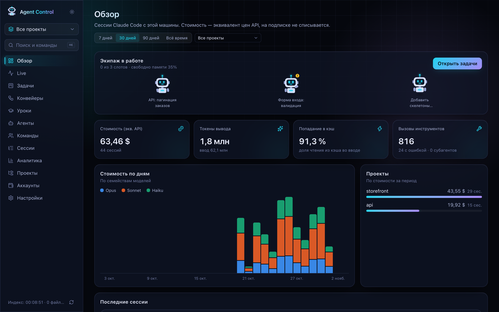
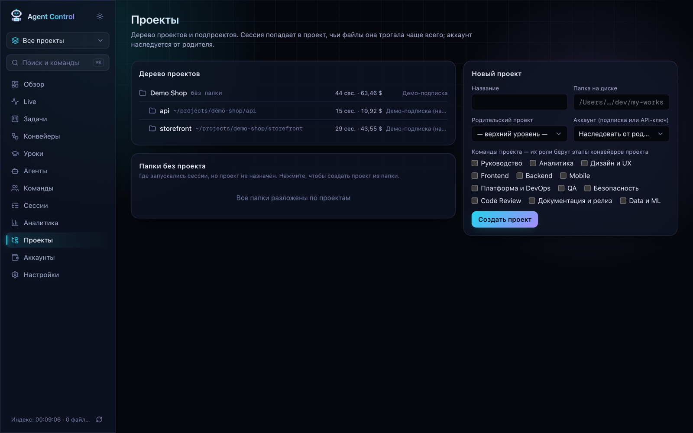
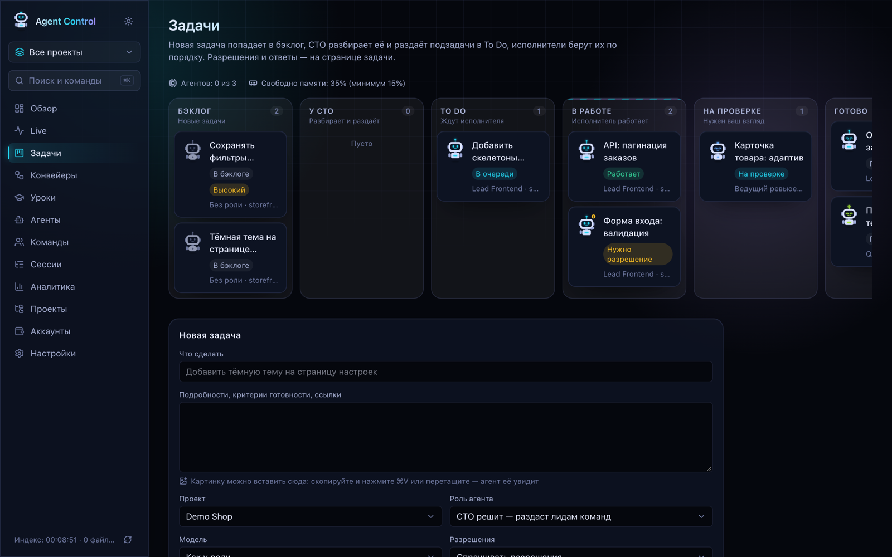
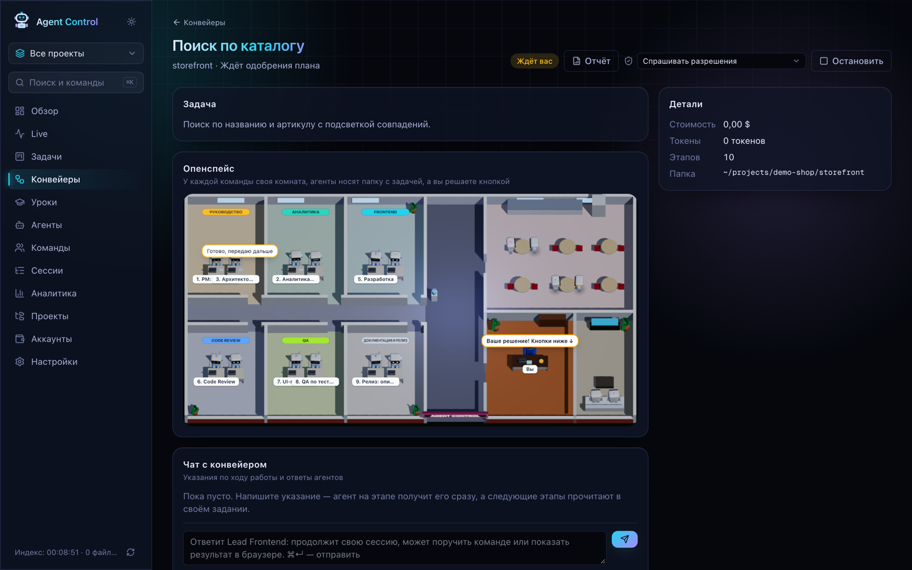
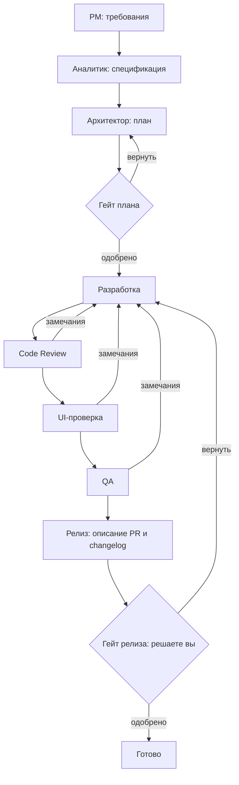
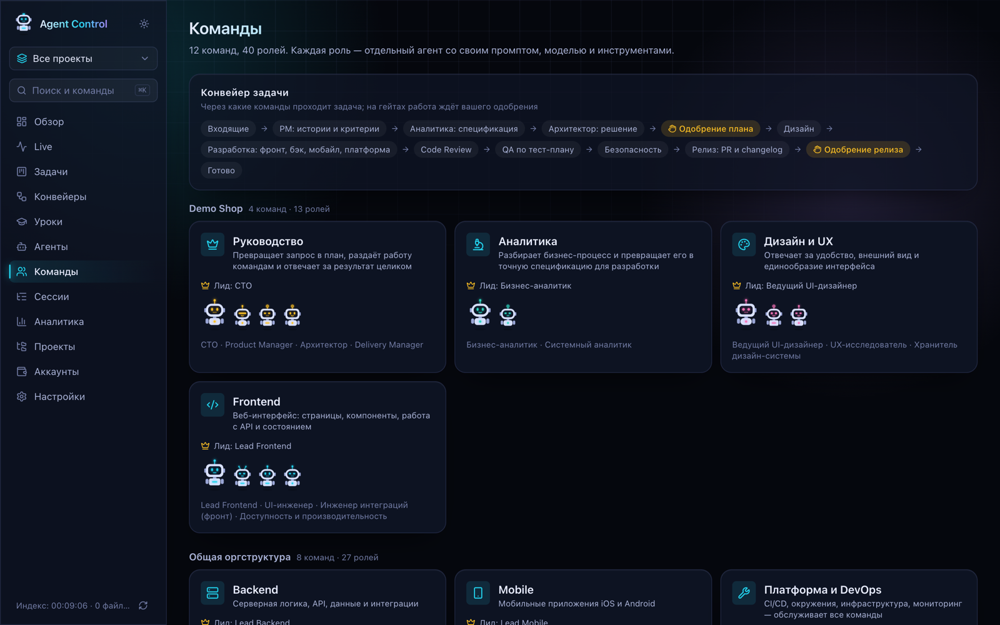
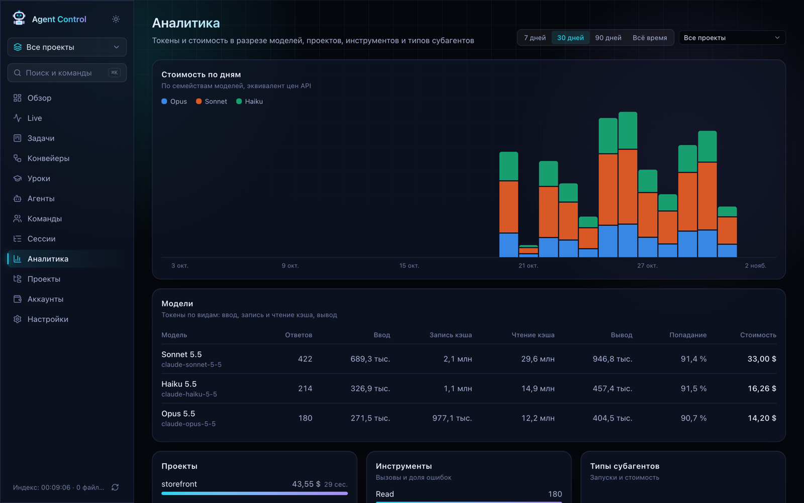

# Agent Control

**Русский** · [English](README.en.md) · [Oʻzbekcha](README.uz.md)

Agent Control превращает Claude Code из одного помощника в терминале в команду, которой вы управляете из браузера. Вы ставите задачу, агенты с разными ролями делают её по очереди, а вы видите весь процесс и решаете важное: что можно агенту, что принять, что выпустить.

Приложение работает только на вашем компьютере. Интерфейс на русском языке. На всех скриншотах вымышленный проект `Demo Shop`.



## Содержание

1. [Зачем это нужно](#зачем-это-нужно)
2. [Основные понятия](#основные-понятия)
3. [Что нужно для работы](#что-нужно-для-работы)
4. [Установка](#установка)
5. [Первая задача за 10 минут](#первая-задача-за-10-минут)
6. [Задача или конвейер](#задача-или-конвейер)
7. [Разделы приложения](#разделы-приложения)
8. [Безопасность](#безопасность)
9. [Где хранятся данные](#где-хранятся-данные)
10. [Если что-то не работает](#если-что-то-не-работает)
11. [Разработка](#разработка)

## Зачем это нужно

В обычном Claude Code вы работаете с одной сессией в терминале и всё держите в голове: что сделано, что проверить, сколько потрачено. Agent Control берёт это на себя:

- показывает все сессии и расходы в одном месте;
- запускает несколько агентов параллельно и не даёт им перегрузить компьютер;
- разделяет работу по ролям, как в настоящей команде: один планирует, другой пишет код, третий проверяет;
- держит каждую задачу в отдельной ветке git, чтобы агент не сломал вашу рабочую копию;
- останавливает работу там, где нужно ваше решение.

## Основные понятия

| Понятие        | Что это простыми словами                                                                                                 |
| -------------- | ------------------------------------------------------------------------------------------------------------------------ |
| **Агент**      | Запущенный Claude Code, который выполняет задачу.                                                                        |
| **Роль**       | «Должность» агента: инструкция (промпт), модель и разрешённые инструменты. Например, «Lead Frontend» или «QA Lead».      |
| **Команда**    | Группа ролей с общим направлением. Из коробки их 12 с 40 ролями. Проект работает с выбранными командами.                 |
| **Лид**        | Главная роль команды. Лид может поручать части работы участникам своей команды.                                          |
| **CTO**        | Особая роль, которая читает задачу, делит её на части и раздаёт лидам.                                                   |
| **Задача**     | Одна единица работы для одного агента.                                                                                   |
| **Конвейер**   | Цепочка этапов, через которую проходит одна большая задача: от требований до релиза.                                     |
| **Этап**       | Один шаг конвейера, который выполняет агент с нужной ролью.                                                              |
| **Гейт**       | Точка остановки в конвейере. Дальше работа идёт только после одобрения.                                                  |
| **Совет**      | Архитектор и лид разработки проекта. В авто-режиме они решают часть вопросов вместо вас.                                 |
| **Сессия**     | Запись одного разговора с Claude Code. Сюда попадают и ваши сессии из терминала, и сессии агентов.                       |
| **Worktree**   | Отдельная копия репозитория на диске со своей веткой. Агент правит файлы там, а ваша папка остаётся нетронутой.          |
| **Хук**        | Маленькая команда, которую Claude Code вызывает при каждом событии. Через неё приложение узнаёт о происходящем сразу.    |
| **Индексатор** | Фоновый процесс, который каждые 15 секунд читает новые строки транскриптов Claude Code и складывает их в локальную базу. |

## Что нужно для работы

| Что               | Зачем                               | Как проверить      |
| ----------------- | ----------------------------------- | ------------------ |
| Node.js 20.9+     | Запускает приложение                | `node -v`          |
| npm               | Ставит зависимости                  | `npm -v`           |
| Git               | Ветки и worktree для агентов        | `git --version`    |
| Claude Code       | Сами агенты, нужен выполненный вход | `claude --version` |
| Подписка или ключ | Claude или API-ключ Anthropic       | `claude`           |

Если Claude Code ещё не установлен:

```bash
npm install -g @anthropic-ai/claude-code
claude   # откроется вход в аккаунт
```

### Операционная система

Приложение написано и проверено на macOS. Запрета на другие системы нет, но три места в коде рассчитаны на macOS:

| Что в коде             | На macOS           | На других системах                                                    |
| ---------------------- | ------------------ | --------------------------------------------------------------------- |
| Хранение API-ключей    | Команда `security` | Не работает: аккаунт с API-ключом использовать нельзя                 |
| Поиск вашего `claude`  | Через `/bin/zsh`   | Без zsh берётся копия Claude Code, встроенная в SDK                   |
| Замер свободной памяти | `memory_pressure`  | Берётся системное значение, оно бывает занижено: снизьте порог памяти |

| Система        | Статус                                                                          |
| -------------- | ------------------------------------------------------------------------------- |
| macOS          | Проверено, работает всё                                                         |
| Linux          | Не проверялось. Ожидается работа с подпиской Claude, без аккаунтов с API-ключом |
| Windows + WSL2 | Не проверялось. Ведёт себя как Linux                                            |
| Windows        | Не проверялось и не рекомендуется: хуки и пути рассчитаны на Unix-окружение     |

## Установка

```bash
# 1. Скачайте проект. Для приватного репозитория сначала выполните gh auth login
git clone https://github.com/Prouzad/agent-control.git
cd agent-control

# 2. Поставьте зависимости
npm install

# 3. Соберите и запустите
npm run build
npm run start
```

Откройте <http://127.0.0.1:4400>. Окно терминала оставьте открытым: пока оно работает, работает и приложение.

При первом запуске создаётся база `~/.agent-control/agent-control.db`, добавляются команды и роли, а индексатор читает ваши транскрипты из `~/.claude`. Примерно через 15 секунд на странице **Обзор** появятся прошлые сессии.

**Обновление:** остановите сервер, проверив, что нет работающих задач, затем выполните `git pull && npm install && npm run build && npm run start`.

## Первая задача за 10 минут

**Шаг 1. Создайте проект.** Откройте **Проекты**, заполните название и папку на диске. Папка должна быть git-репозиторием. Отметьте команды, например «Руководство», «Frontend» и «Code Review».



**Шаг 2. Установите хуки.** Откройте **Настройки** и нажмите **Установить хуки**. Затем откройте новую сессию Claude Code: хуки действуют только в новых сессиях.

**Шаг 3. Создайте задачу.** Откройте **Задачи** и заполните блок **Новая задача**:

- **Что сделать:** одна фраза, например «Добавить тёмную тему на страницу настроек».
- **Подробности:** что считать готовым, ссылки. Картинку можно вставить прямо сюда.
- **Проект:** созданный на шаге 1.
- **Роль агента:** для первого раза выберите конкретную роль, например «Lead Frontend».
- **Разрешения:** «Спрашивать разрешения».
- **Изоляция:** «Отдельный git worktree».
- **Лимит стоимости:** например, `2`. На этой сумме агент остановится.

**Шаг 4. Следите за работой.** Откройте задачу. Вы увидите, что агент читает и меняет. Когда он попросит разрешение, на странице появятся кнопки **Разрешить** и **Отклонить**.

**Шаг 5. Проверьте результат.** Когда агент закончит, задача перейдёт в колонку «На проверке». Прочитайте отчёт и посмотрите изменения. Нажмите **Принять** или продолжите диалог, написав агенту замечания. Изменения остаются в ветке задачи: переносить их в основную ветку вы решаете сами.

## Задача или конвейер

| Ситуация                                        | Что выбрать                      |
| ----------------------------------------------- | -------------------------------- |
| Понятная мелочь: поправить текст, добавить тест | Задача с конкретной ролью        |
| Работа для нескольких команд                    | Задача с ролью «CTO решит»       |
| Новая функция с требованиями, кодом и проверкой | Конвейер, шаблон «Полный»        |
| Код уже понятен, нужна разработка с проверками  | Конвейер, шаблон «Быстрый»       |
| Сначала нужно разобраться, код писать рано      | Конвейер, шаблон «Только анализ» |

Обычную задачу можно превратить в конвейер кнопкой **Запустить как конвейер**.

## Разделы приложения

### Обзор

Главная страница. Показывает, какие агенты сейчас работают, сколько свободно слотов и памяти, сколько потрачено за период и какие проекты самые дорогие. Здесь удобно начинать день: сразу видно, кто ждёт вашего решения.

Стоимость считается по ценам API. На подписке это эквивалент для сравнения, а не реальное списание.

### Live

«Зал агентов»: что происходит прямо сейчас. Для каждой активной сессии видны текущий инструмент, субагенты и ожидание вашего ответа. С хуками события приходят мгновенно, без хуков активные сессии определяются по записи транскриптов с задержкой.

### Задачи



Канбан-доска. Задача движется слева направо:

| Колонка     | Что происходит                                                      |
| ----------- | ------------------------------------------------------------------- |
| Бэклог      | Задача записана, но не запущена                                     |
| У CTO       | CTO делит задачу на части                                           |
| To Do       | Задача в очереди и ждёт свободный слот                              |
| В работе    | Агент работает. Статус «Нужно разрешение» означает, что он ждёт вас |
| На проверке | Агент закончил, результат ждёт вашего взгляда                       |
| Готово      | Результат принят                                                    |

Что можно сделать на странице задачи:

- **Запустить**, **Остановить**, **Убрать из очереди**;
- **Разрешить** или **Отклонить** запрос агента;
- написать агенту в чат: он продолжит ту же сессию и помнит контекст;
- **Принять** результат или **Вернуть в бэклог**;
- **Продолжить** прерванную или неудачную задачу с того же места;
- **Запустить как конвейер**.

**Режимы разрешений** определяют, как часто агент будет вас спрашивать:

| Режим                      | Как ведёт себя агент                                               |
| -------------------------- | ------------------------------------------------------------------ |
| Спрашивать разрешения      | Спрашивает перед каждым действием, которое требует согласия        |
| Правки файлов без вопросов | Сам меняет файлы, остальное спрашивает                             |
| Авто                       | Безопасное делает сам, рискованное спрашивает. Первым решает совет |
| Только план                | Изучает и пишет план, ничего не меняет                             |

**Роль «CTO решит».** CTO изучает задачу и предлагает раздачу по лидам. На странице задачи вы видите предложение и нажимаете **Запустить лидов по очереди** или **Отклонить раздачу**. Лиды работают по порядку, затем CTO сводит общий итог.

**Изоляция.** «Отдельный git worktree» безопасен: агент работает в своей ветке. «Прямо в папке проекта» меняет ваши файлы напрямую, поэтому подходит только когда вы понимаете последствия.

### Конвейеры



**Что это такое.** Конвейер работает как процесс в настоящей команде. Представьте задачу «Сделать поиск по каталогу». Сначала менеджер описывает требования, аналитик уточняет детали, архитектор составляет план. Потом разработчик пишет код, ревьюер и тестировщики проверяют, а релиз-менеджер готовит описание. Конвейер делает то же самое силами агентов: каждый этап выполняет отдельный агент со своей ролью, и каждый следующий получает результаты предыдущих.

Обычная задача — это один исполнитель. Конвейер — это вся команда и контроль качества, поэтому он дороже и дольше, но надёжнее на больших задачах.



**Что делает каждый этап:**

| Этап                      | Результат                                               | Меняет код |
| ------------------------- | ------------------------------------------------------- | ---------- |
| PM                        | Проблема, user stories, критерии приёмки                | Нет        |
| Аналитика                 | Спецификация: сущности, API, состояния, ошибки          | Нет        |
| Архитектор                | План: какие файлы менять, риски, порядок, модель на шаг | Нет        |
| Дизайн (по желанию)       | Состояния интерфейса, сверка с макетом                  | Нет        |
| Разработка                | Код, проверки проекта, коммит в ветку конвейера         | Да         |
| Code Review               | Проверка изменений и вердикт                            | Нет        |
| UI-проверка               | Экраны в браузере на разных ширинах и вердикт           | Нет        |
| QA                        | Тест-план, проверки и вердикт                           | Нет        |
| Безопасность (по желанию) | Поиск уязвимостей и вердикт                             | Нет        |
| Релиз                     | Текст описания PR и запись для changelog                | Нет        |

**Как запустить:**

1. Откройте **Конвейеры** и создайте новый.
2. Опишите задачу, приложите ссылки на требования и макеты.
3. Выберите проект. Папка должна быть git-репозиторием.
4. Выберите шаблон или соберите свой набор этапов.
5. Задайте лимит на этап, например `3` доллара.
6. Запустите. Все этапы работают в одном общем worktree и одной ветке.

**Кто решает на гейтах.** Это важно понимать заранее:

- **Гейт плана** сначала решает совет: архитектор и лид разработки. Если они не согласны или вопрос выше их уровня, решает CTO. Вам вопрос придёт, только если без человека нельзя.
- **Гейт релиза** всегда решаете вы. Здесь вы видите итог всей работы и нажимаете **Одобрить** или **Вернуть на доработку**.

**Что происходит при замечаниях.** Ревью, UI-проверка и QA заканчивают работу вердиктом «одобрено» или «доработать». При «доработать» конвейер сам возвращает работу разработчику, и тот продолжает свою сессию. Таких кругов автоматически не больше двух. Если проблемы остались, решение поднимается к совету, а затем к вам: **Принять как есть** или остановить.

**Как вмешаться по ходу.** В блоке **Чат с конвейером** можно написать указание. Агент на текущем этапе получит его сразу, а следующие этапы прочитают его в своём задании. Комментарий на гейте работает так же, поэтому ревьюер не будет спорить с вашим решением.

**Опенспейс.** Картинка в центре страницы показывает работу наглядно: у каждой команды своя комната, агенты сидят за столами, при передаче работы носят папку, а вы сидите за своим столом, где ждёт решение.

**Отчёт.** Кнопка **Отчёт** открывает сводку простым языком: что сделано, что проверили, какие проблемы и блокеры остались, какие решения приняты и что делать дальше.

**После завершения.** Конвейер уходит в архив и удаляется через 14 дней. Модель также выводит из ошибок конвейера до трёх уроков. Код остаётся в ветке: агенты не пушат и не мержат.

### Уроки

Память проекта об ошибках. После каждого конвейера модель смотрит, что шло не так: возвраты на доработку, ваши поправки, отказы. Из этого она выводит до трёх коротких правил, например «Списки каталога всегда проверять с пустым результатом». Агенты получают уроки своего проекта и роли в начале работы.

Урок можно отредактировать, закрепить, чтобы он приходил всегда, отправить в архив или удалить. Действующих уроков не больше 40: старые незакреплённые уходят в архив сами.

### Агенты

Все роли и их роботы. Здесь можно открыть роль и изменить её название, описание, промпт, модель и инструменты, создать новую роль и посмотреть, как она будет выглядеть в формате `.claude/agents`. Робот у роли постоянный, поэтому агента легко узнать на задачах и в офисе. Его вид показывает состояние: работает, ждёт решения, ошибка, готово.

Модель стоит выбирать по сложности: Haiku для мелочей, Sonnet для понятной работы по плану, Opus для новой логики и ревью, Fable для самых трудных задач.

### Команды



Оргструктура: команды, лиды и участники. Сверху показан общий путь задачи, ниже команды сгруппированы по проектам. Команды проекта определяют, какие роли возьмутся за этапы его конвейеров.

### Сессии

История всех сессий Claude Code: и агентов, и ваших из терминала. На странице сессии видны модели, инструменты, субагенты, стоимость и хронология действий. Раздел полезен, когда нужно понять, что агент делал и где ошибся.

### Аналитика



Отвечает на вопрос «куда уходят токены». Показывает стоимость по дням, таблицу моделей, расходы по проектам, инструменты с долей ошибок и типы субагентов. **Попадание в кэш** показывает, какая часть ввода взята из кэша: чем выше, тем дешевле.

### Проекты

Дерево проектов. У проекта есть папка, аккаунт и команды. Родительский проект без папки объединяет несколько репозиториев, а подпроекты наследуют его аккаунт. Сессия попадает в проект, чьи файлы она трогала чаще всего. Папки, где сессии были, но проект не создан, показаны в блоке «Папки без проекта»: нажмите на папку, чтобы создать проект.

Селектор **Все проекты** в боковой панели сужает всё приложение до одного проекта.

### Аккаунты

Какими аккаунтами Claude работают агенты. Основная подписка уже добавлена и указывает на `~/.claude`.

- **Подписка Claude.** Для второго аккаунта задайте папку и один раз войдите: `CLAUDE_CONFIG_DIR=~/.claude-accounts/work claude`.
- **API-ключ Anthropic.** Ключ сохраняется в Связке ключей macOS, а не в базе. Оплата идёт по факту использования.

Документация Agent SDK ограничивает вход через claude.ai в сторонних продуктах. Agent Control задуман как личный локальный инструмент. Если это не подходит для вашего случая, используйте аккаунт с API-ключом.

### Настройки

| Настройка                     | Что делает                                                                                                         |
| ----------------------------- | ------------------------------------------------------------------------------------------------------------------ |
| Параллельные агенты           | Сколько задач работает одновременно. По умолчанию 3                                                                |
| Минимум свободной памяти      | Ниже этого порога новые задачи ждут. По умолчанию 15%                                                              |
| Чтение `.env` агентами        | Разрешает читать `.env` проектов. Менять их агенты не могут никогда                                                |
| Агенты как сессия в терминале | Агенты используют ваш `claude`, его инструменты, MCP и настройки. Списки инструментов ролей перестают ограничивать |
| Совет в авто-режиме           | Запросы разрешений сначала решают архитектор и лид, при разногласии CTO                                            |
| Хуки                          | Установка и удаление хуков для каждого аккаунта                                                                    |
| Видимость проектов            | Скрытый проект и всё связанное с ним пропадает из приложения                                                       |

### Полезные мелочи

- **⌘K** (Ctrl+K) открывает поиск и быстрые команды.
- Значок солнца в боковой панели переключает тёмную и светлую темы.

## Безопасность

- Сервер слушает только `127.0.0.1`. Не открывайте порт в сеть: в транскриптах бывают код и секреты, а через интерфейс можно управлять агентами.
- Агенты не читают сами `~/.ssh`, `~/.aws`, `.npmrc`, файлы токенов, ключи и Связку ключей. На такие действия приходит запрос, даже в авто-режиме.
- Push, merge, `--force`, публикация пакетов, удаление вне рабочей папки и публикация наружу в авто-режиме всегда идут к человеку.
- Режимы разрешений и правила не отменяют здравый смысл. Перед приёмом читайте изменения и перед объединением веток прогоняйте проверки проекта.

## Где хранятся данные

Всё остаётся на вашем компьютере, облачного сервиса у приложения нет. Сами запросы агентов обрабатывает Claude, как и при обычной работе с Claude Code.

| Данные               | Где лежат                                          |
| -------------------- | -------------------------------------------------- |
| База                 | `~/.agent-control/agent-control.db`                |
| Worktree агентов     | `~/.agent-control/worktrees`                       |
| API-ключи            | Связка ключей macOS, служба `agent-control`        |
| Копии настроек хуков | `settings.json.bak-agent-control-…` рядом с файлом |

Claude Code удаляет транскрипты старше `cleanupPeriodDays` (по умолчанию 30 дней), а база хранит всё, что уже проиндексировано.

| Переменная окружения      | Назначение                                                  |
| ------------------------- | ----------------------------------------------------------- |
| `AGENT_CONTROL_DATA`      | Папка данных вместо `~/.agent-control`                      |
| `AGENT_CONTROL_UI_ONLY=1` | Сервер только для просмотра, без агентов, для второго порта |
| `AGENT_CONTROL_DEBUG=1`   | Подробный лог запуска агентов                               |

## Если что-то не работает

| Проблема                                      | Что делать                                                                                                          |
| --------------------------------------------- | ------------------------------------------------------------------------------------------------------------------- |
| `Not logged in`                               | Запустите `claude` и войдите. Не задавайте `CLAUDE_CONFIG_DIR=~/.claude` для стандартного профиля                   |
| Порт 4400 занят                               | Найдите процесс: `lsof -nP -iTCP:4400 -sTCP:LISTEN`. Сначала убедитесь, что это не работающий Agent Control         |
| `npm install` падает на `better-sqlite3`      | На macOS поставьте инструменты сборки: `xcode-select --install`, затем повторите                                    |
| Задача не выходит из очереди                  | Заняты все слоты или мало памяти. Счётчики есть над доской, лимиты меняются в настройках                            |
| Агент не стартует в проекте                   | Папка проекта должна быть git-репозиторием                                                                          |
| Агенты остановились после перезапуска сервера | Перезапуск обрывает работающих агентов. Перед ним проверяйте задачи, а прерванную продолжите кнопкой **Продолжить** |
| Live пуст                                     | Установите хуки и начните новую сессию Claude Code                                                                  |
| Нет старых сессий                             | Claude Code удалил эти транскрипты ещё до первой индексации                                                         |
| Конвейер долго стоит                          | Откройте его: возможно, он ждёт вашего решения на гейте или разрешения на этапе                                     |

## Разработка

```bash
npm run dev        # http://127.0.0.1:4400
npm run validate   # lint + типы + prettier + сборка
```

Стек: Next.js 16, React 19, Tailwind CSS 4, SQLite (better-sqlite3) и Claude Agent SDK.
