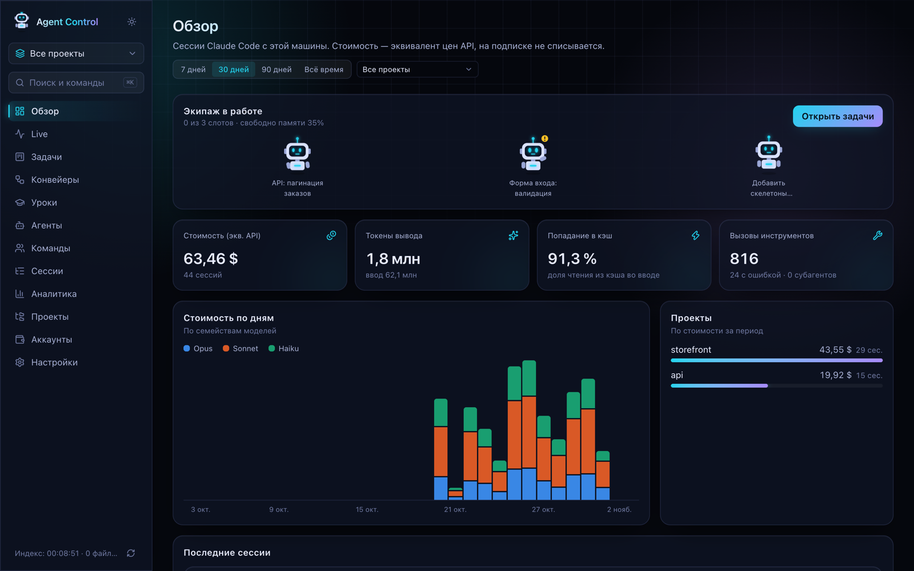
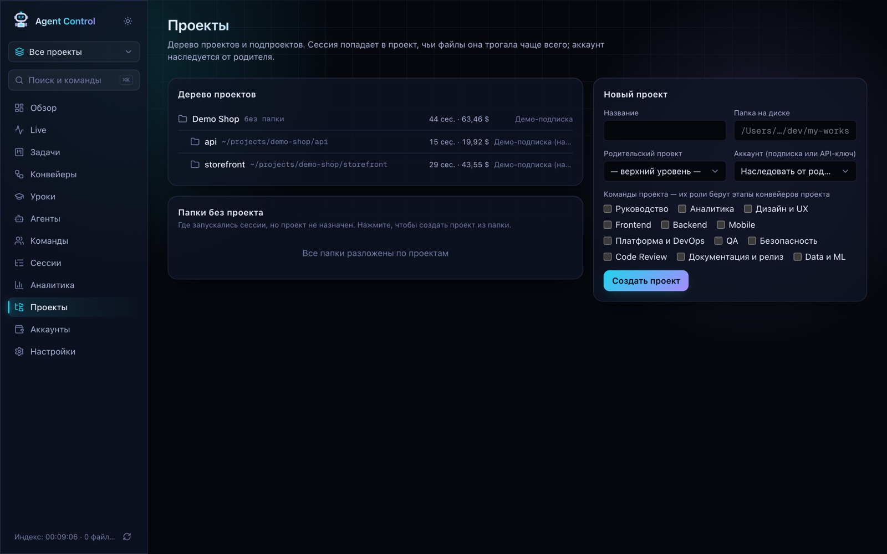
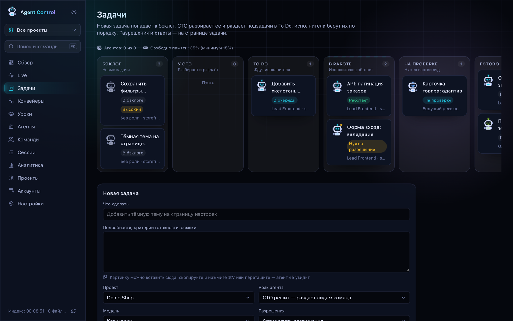
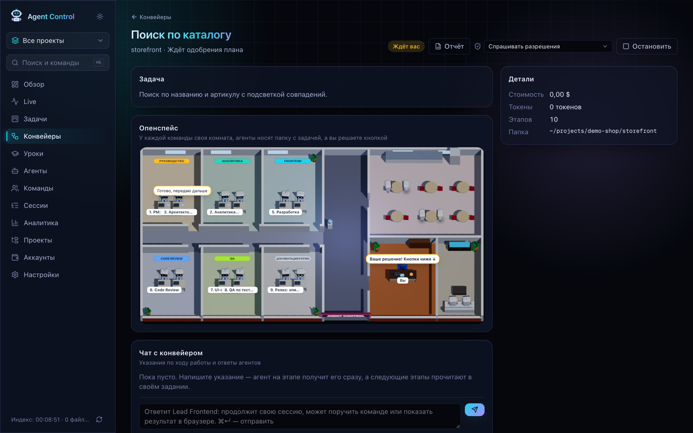
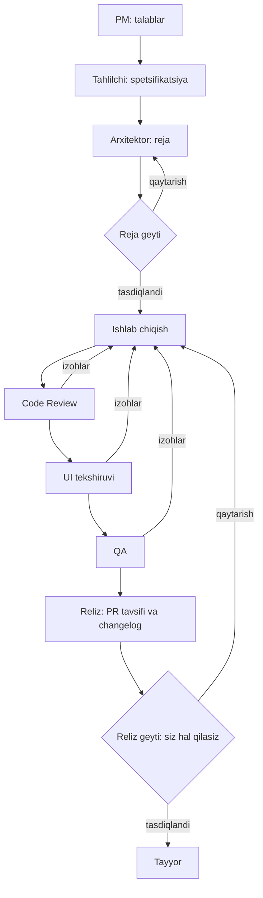
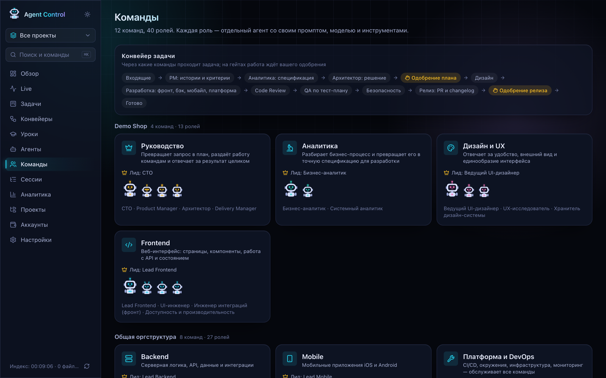
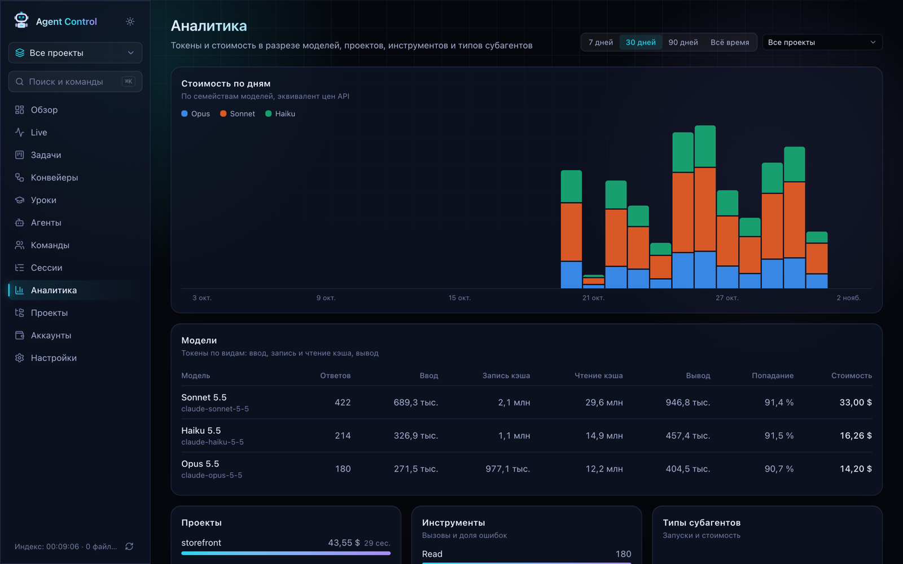

# Agent Control

[Русский](README.md) · [English](README.en.md) · **Oʻzbekcha**

Agent Control Claude Code’ni terminaldagi bitta yordamchidan brauzer orqali boshqariladigan jamoaga aylantiradi. Siz vazifa qoʻyasiz, turli roldagi agentlar uni navbat bilan bajaradi, siz esa butun jarayonni koʻrib, muhim qarorlarni qabul qilasiz: agentga nima mumkin, nimani qabul qilish, nimani reliz qilish.

Ilova faqat oʻz kompyuteringizda ishlaydi. Interfeys rus tilida, shuning uchun qoʻllanmada ruscha nomlar tarjimasi bilan berilgan. Barcha skrinshotlarda oʻylab topilgan `Demo Shop` loyihasi koʻrsatilgan.



## Mundarija

1. [Bu nima uchun kerak](#bu-nima-uchun-kerak)
2. [Asosiy tushunchalar](#asosiy-tushunchalar)
3. [Talablar](#talablar)
4. [Oʻrnatish](#oʻrnatish)
5. [Birinchi vazifa 10 daqiqada](#birinchi-vazifa-10-daqiqada)
6. [Vazifa yoki konveyer](#vazifa-yoki-konveyer)
7. [Ilova boʻlimlari](#ilova-boʻlimlari)
8. [Xavfsizlik](#xavfsizlik)
9. [Maʼlumotlar qayerda saqlanadi](#maʼlumotlar-qayerda-saqlanadi)
10. [Muammolar va yechimlar](#muammolar-va-yechimlar)
11. [Ishlab chiqish](#ishlab-chiqish)

## Bu nima uchun kerak

Oddiy Claude Code’da siz terminaldagi bitta sessiyada ishlaysiz va hammasini yodda tutasiz: nima qilindi, nimani tekshirish kerak, qancha sarflandi. Agent Control buni oʻz zimmasiga oladi:

- barcha sessiyalar va xarajatlarni bir joyda koʻrsatadi;
- bir nechta agentni parallel ishga tushiradi va kompyuterni ortiqcha yuklamaydi;
- ishni haqiqiy jamoadagidek rollarga boʻladi: biri rejalashtiradi, boshqasi kod yozadi, uchinchisi tekshiradi;
- har bir vazifani alohida git shoxchasida saqlaydi, shunda agent ishchi nusxangizni buzmaydi;
- qaroringiz kerak boʻlgan joyda toʻxtaydi.

## Asosiy tushunchalar

| Tushuncha      | Oddiy soʻzlar bilan                                                                                                                 |
| -------------- | ----------------------------------------------------------------------------------------------------------------------------------- |
| **Agent**      | Vazifani bajarayotgan ishga tushirilgan Claude Code.                                                                                |
| **Rol**        | Agentning “lavozimi”: koʻrsatma (prompt), model va ruxsat etilgan vositalar. Masalan, Lead Frontend yoki QA Lead.                   |
| **Jamoa**      | Umumiy yoʻnalishdagi rollar guruhi. Tayyor holda 12 ta jamoa va 40 ta rol bor. Loyiha tanlangan jamoalar bilan ishlaydi.            |
| **Lid**        | Jamoaning asosiy roli. Lid ishning qismlarini jamoa aʼzolariga topshirishi mumkin.                                                  |
| **CTO**        | Vazifani oʻqib, qismlarga boʻladigan va lidlarga tarqatadigan maxsus rol.                                                           |
| **Vazifa**     | Bitta agent uchun bitta ish birligi.                                                                                                |
| **Konveyer**   | Bitta katta vazifa talablardan relizgacha oʻtadigan bosqichlar zanjiri.                                                             |
| **Bosqich**    | Kerakli roldagi agent bajaradigan konveyerning bitta qadami.                                                                        |
| **Geyt**       | Konveyerdagi toʻxtash nuqtasi. Ish faqat tasdiqlangandan keyin davom etadi.                                                         |
| **Kengash**    | Loyihaning arxitektori va ishlab chiqish lidi. Avto rejimda ular baʼzi savollarni siz uchun hal qiladi.                             |
| **Sessiya**    | Claude Code bilan bitta suhbat yozuvi. Bunga agentlar sessiyalari ham, terminaldagi oʻz sessiyalaringiz ham kiradi.                 |
| **Worktree**   | Repozitoriyning diskdagi oʻz shoxchasiga ega alohida nusxasi. Agent fayllarni shu yerda oʻzgartiradi, sizning papkangizga tegmaydi. |
| **Hook**       | Claude Code har bir hodisada chaqiradigan kichik buyruq. U orqali ilova voqealarni darhol biladi.                                   |
| **Indeksator** | Claude Code transkriptlarining yangi qatorlarini har 15 soniyada oʻqib, lokal bazaga yozadigan fon jarayoni.                        |

## Talablar

| Nima             | Nima uchun                                         | Qanday tekshiriladi |
| ---------------- | -------------------------------------------------- | ------------------- |
| Node.js 20.9+    | Ilovani ishga tushiradi                            | `node -v`           |
| npm              | Bogʻliqliklarni oʻrnatadi                          | `npm -v`            |
| Git              | Agentlar uchun shoxcha va worktree                 | `git --version`     |
| Claude Code      | Agentlarning oʻzi, tizimga kirilgan boʻlishi kerak | `claude --version`  |
| Obuna yoki kalit | Claude obunasi yoki Anthropic API kaliti           | `claude`            |

Agar Claude Code hali oʻrnatilmagan boʻlsa:

```bash
npm install -g @anthropic-ai/claude-code
claude   # tizimga kirish ochiladi
```

### Operatsion tizim

Ilova macOS’da yozilgan va tekshirilgan. Boshqa tizimlarga taqiq yoʻq, lekin kodning uch joyi macOS’ga moslangan:

| Kodda                   | macOS’da            | Boshqa tizimlarda                                                               |
| ----------------------- | ------------------- | ------------------------------------------------------------------------------- |
| API kalitlarni saqlash  | `security` buyrugʻi | Ishlamaydi: API kalitli akkauntdan foydalanib boʻlmaydi                         |
| `claude` ni topish      | `/bin/zsh` orqali   | zsh boʻlmasa, SDK ichidagi Claude Code nusxasi ishlatiladi                      |
| Boʻsh xotirani oʻlchash | `memory_pressure`   | Tizim qiymati olinadi, u past koʻrinishi mumkin: xotira chegarasini kamaytiring |

| Tizim          | Holati                                                                          |
| -------------- | ------------------------------------------------------------------------------- |
| macOS          | Tekshirilgan, hammasi ishlaydi                                                  |
| Linux          | Tekshirilmagan. Claude obunasi bilan ishlashi kutiladi, API kalitli akkauntsiz  |
| Windows + WSL2 | Tekshirilmagan. Linux kabi ishlaydi                                             |
| Windows        | Tekshirilmagan va tavsiya etilmaydi: hooklar va yoʻllar Unix muhitiga moslangan |

## Oʻrnatish

```bash
# 1. Loyihani yuklab oling. Xususiy repozitoriy uchun avval gh auth login bajaring
git clone https://github.com/Prouzad/agent-control.git
cd agent-control

# 2. Bogʻliqliklarni oʻrnating
npm install

# 3. Yigʻing va ishga tushiring
npm run build
npm run start
```

<http://127.0.0.1:4400> manzilini oching. Terminal oynasini yopmang: u ishlab turganda ilova ham ishlaydi.

Birinchi ishga tushirishda `~/.agent-control/agent-control.db` bazasi yaratiladi, jamoalar va rollar qoʻshiladi, indeksator esa `~/.claude` ichidagi transkriptlarni oʻqiydi. Taxminan 15 soniyadan keyin **Обзор** (Umumiy koʻrinish) sahifasida oldingi sessiyalar paydo boʻladi.

**Yangilash:** ishlayotgan vazifalar yoʻqligini tekshirib, serverni toʻxtating, soʻng `git pull && npm install && npm run build && npm run start` buyrugʻini bajaring.

## Birinchi vazifa 10 daqiqada

**1-qadam. Loyiha yarating.** **Проекты** (Loyihalar) sahifasini oching, nomini va diskdagi papkani kiriting. Papka git repozitoriy boʻlishi kerak. Jamoalarni belgilang, masalan Руководство (Rahbariyat), Frontend va Code Review.



**2-qadam. Hooklarni oʻrnating.** **Настройки** (Sozlamalar) sahifasini oching va **Установить хуки** (Hooklarni oʻrnatish) tugmasini bosing. Keyin yangi Claude Code sessiyasini oching: hooklar faqat yangi sessiyalarda ishlaydi.

**3-qadam. Vazifa yarating.** **Задачи** (Vazifalar) sahifasini oching va **Новая задача** (Yangi vazifa) blokini toʻldiring:

- **Что сделать** (Nima qilish kerak): bitta jumla, masalan “Sozlamalar sahifasiga qorongʻi mavzu qoʻshish”.
- **Подробности** (Tafsilotlar): nima tayyor deb hisoblanadi, havolalar. Rasmni shu yerga qoʻyish mumkin.
- **Проект** (Loyiha): 1-qadamda yaratilgani.
- **Роль агента** (Agent roli): birinchi marta aniq rolni tanlang, masalan Lead Frontend.
- **Разрешения** (Ruxsatlar): Спрашивать разрешения (Ruxsat soʻrash).
- **Изоляция** (Izolyatsiya): Отдельный git worktree (Alohida git worktree).
- **Лимит стоимости** (Xarajat chegarasi): masalan, `2`. Agent shu summada toʻxtaydi.

**4-qadam. Ishni kuzating.** Vazifani oching. Agent nimani oʻqiyotgani va oʻzgartirayotganini koʻrasiz. U ruxsat soʻraganda sahifada **Разрешить** (Ruxsat berish) va **Отклонить** (Rad etish) tugmalari chiqadi.

**5-qadam. Natijani tekshiring.** Agent tugatgach, vazifa На проверке (Tekshiruvda) ustuniga oʻtadi. Hisobotni oʻqing va oʻzgarishlarni koʻring. **Принять** (Qabul qilish) tugmasini bosing yoki izohlaringizni agentga yozib, ishni davom ettiring. Oʻzgarishlar vazifa shoxchasida qoladi: ularni asosiy shoxchaga oʻtkazishni oʻzingiz hal qilasiz.

## Vazifa yoki konveyer

| Holat                                          | Nimani tanlash                            |
| ---------------------------------------------- | ----------------------------------------- |
| Aniq mayda ish: matnni tuzatish, test qoʻshish | Aniq rolli vazifa                         |
| Bir nechta jamoa uchun ish                     | “CTO решит” (CTO hal qiladi) rolli vazifa |
| Talablar, kod va tekshiruvli yangi funksiya    | Konveyer, toʻliq shablon                  |
| Kod aniq, ishlab chiqish va tekshiruv kerak    | Konveyer, tezkor shablon                  |
| Avval tushunib olish kerak, kod yozishga erta  | Konveyer, faqat tahlil shabloni           |

Oddiy vazifani **Запустить как конвейер** (Konveyer sifatida ishga tushirish) tugmasi bilan konveyerga aylantirish mumkin.

## Ilova boʻlimlari

### Обзор (Umumiy koʻrinish)

Bosh sahifa. Qaysi agentlar ishlayotgani, boʻsh slotlar va xotira, davr uchun xarajat va eng qimmat loyihalarni koʻrsatadi. Kunni shu yerdan boshlash qulay: kim qaroringizni kutayotgani darhol koʻrinadi.

Xarajat API narxlari boʻyicha hisoblanadi. Obunada bu solishtirish uchun ekvivalent, haqiqiy toʻlov emas.

### Live

“Agentlar zali”: hozir nima boʻlayotgani. Har bir faol sessiya uchun joriy vosita, subagentlar va javobingizni kutayotgani koʻrinadi. Hooklar bilan hodisalar darhol keladi. Hooklarsiz faol sessiyalar transkriptga yozilishi orqali kechikish bilan aniqlanadi.

### Задачи (Vazifalar)



Kanban doska. Vazifa chapdan oʻngga harakatlanadi:

| Ustun                     | Nima boʻladi                                                       |
| ------------------------- | ------------------------------------------------------------------ |
| Бэклог (Beklog)           | Vazifa yozilgan, lekin ishga tushirilmagan                         |
| У CTO (CTO’da)            | CTO vazifani qismlarga boʻlmoqda                                   |
| To Do                     | Vazifa navbatda, boʻsh slot kutmoqda                               |
| В работе (Ishda)          | Agent ishlamoqda. “Нужно разрешение” sizni kutayotganini bildiradi |
| На проверке (Tekshiruvda) | Agent tugatdi, natija sizning koʻrigingizni kutmoqda               |
| Готово (Tayyor)           | Natija qabul qilingan                                              |

Vazifa sahifasida quyidagilarni qilish mumkin:

- ishga tushirish, toʻxtatish yoki navbatdan olib tashlash;
- agent soʻroviga ruxsat berish yoki rad etish;
- chatda agentga yozish: u oʻsha sessiyani davom ettiradi va kontekstni eslaydi;
- natijani qabul qilish yoki vazifani beklogga qaytarish;
- uzilgan yoki muvaffaqiyatsiz vazifani **Продолжить** tugmasi bilan toʻxtagan joyidan davom ettirish;
- konveyer sifatida ishga tushirish.

**Ruxsat rejimlari** agent sizdan qanchalik tez-tez soʻrashini belgilaydi:

| Rejim                                               | Agent oʻzini qanday tutadi                                                    |
| --------------------------------------------------- | ----------------------------------------------------------------------------- |
| Спрашивать разрешения (Ruxsat soʻrash)              | Rozilik kerak boʻlgan har bir amaldan oldin soʻraydi                          |
| Правки файлов без вопросов (Soʻramasdan tahrirlash) | Fayllarni oʻzi oʻzgartiradi, qolganini soʻraydi                               |
| Авто (Avto)                                         | Xavfsiz ishlarni oʻzi qiladi, xavflilarini soʻraydi. Avval kengash hal qiladi |
| Только план (Faqat reja)                            | Oʻrganadi va reja yozadi, hech narsani oʻzgartirmaydi                         |

**“CTO решит” roli.** CTO vazifani oʻrganib, lidlar orasida taqsimlashni taklif qiladi. Vazifa sahifasida taklifni koʻrasiz va **Запустить лидов по очереди** (Lidlarni navbat bilan ishga tushirish) yoki **Отклонить раздачу** (Taqsimotni rad etish) tugmasini bosasiz. Lidlar tartib bilan ishlaydi, keyin CTO umumiy xulosa chiqaradi.

**Izolyatsiya.** Alohida git worktree xavfsiz: agent oʻz shoxchasida ishlaydi. Прямо в папке проекта (Toʻgʻridan-toʻgʻri loyiha papkasida) fayllaringizni bevosita oʻzgartiradi, shuning uchun oqibatlarini tushungan holda ishlating.

### Конвейеры (Konveyerlar)



**Bu nima.** Konveyer haqiqiy jamoadagi jarayon kabi ishlaydi. “Katalog boʻyicha qidiruv yaratish” vazifasini tasavvur qiling. Avval menejer talablarni yozadi, tahlilchi tafsilotlarni aniqlaydi, arxitektor reja tuzadi. Keyin dasturchi kod yozadi, review qiluvchilar va testerlar tekshiradi, reliz menejeri esa tavsifni tayyorlaydi. Konveyer xuddi shuni agentlar bilan bajaradi: har bir bosqichni oʻz roliga ega alohida agent bajaradi va har bir keyingi bosqich oldingilarining natijalarini oladi.

Oddiy vazifa bu bitta ijrochi. Konveyer bu butun jamoa va sifat nazorati, shuning uchun u qimmatroq va uzoqroq, lekin katta vazifalarda ishonchliroq.



**Har bir bosqich nima qiladi:**

| Bosqich                | Natija                                                    | Kodni oʻzgartiradimi |
| ---------------------- | --------------------------------------------------------- | -------------------- |
| PM                     | Muammo, user story, qabul mezonlari                       | Yoʻq                 |
| Tahlil                 | Spetsifikatsiya: obyektlar, API, holatlar, xatolar        | Yoʻq                 |
| Arxitektor             | Reja: qaysi fayllar, xavflar, tartib, qadam uchun model   | Yoʻq                 |
| Dizayn (ixtiyoriy)     | Interfeys holatlari, maket bilan solishtirish             | Yoʻq                 |
| Ishlab chiqish         | Kod, loyiha tekshiruvlari, konveyer shoxchasiga commit    | Ha                   |
| Code Review            | Oʻzgarishlarni tekshirish va xulosa                       | Yoʻq                 |
| UI tekshiruvi          | Ekranlarni brauzerda turli kengliklarda koʻrish va xulosa | Yoʻq                 |
| QA                     | Test rejasi, tekshiruvlar va xulosa                       | Yoʻq                 |
| Xavfsizlik (ixtiyoriy) | Zaifliklarni qidirish va xulosa                           | Yoʻq                 |
| Reliz                  | PR tavsifi matni va changelog yozuvi                      | Yoʻq                 |

**Qanday ishga tushiriladi:**

1. **Конвейеры** sahifasini oching va yangisini yarating.
2. Vazifani tasvirlang, talablar va maketlarga havolalar qoʻshing.
3. Loyihani tanlang. Uning papkasi git repozitoriy boʻlishi kerak.
4. Shablon tanlang yoki oʻz bosqichlaringizni tuzing.
5. Bosqich uchun chegara belgilang, masalan `3` dollar.
6. Ishga tushiring. Barcha bosqichlar bitta umumiy worktree va bitta shoxchada ishlaydi.

**Geytlarda kim hal qiladi.** Buni oldindan bilish muhim:

- **Reja geytini** avval kengash hal qiladi: arxitektor va ishlab chiqish lidi. Ular kelisha olmasa yoki savol ularning darajasidan yuqori boʻlsa, CTO hal qiladi. Savol sizga faqat odam albatta kerak boʻlganda keladi.
- **Reliz geytini** har doim siz hal qilasiz. Bu yerda butun ish natijasini koʻrib, **Одобрить** (Tasdiqlash) yoki **Вернуть на доработку** (Qayta ishlashga qaytarish) tugmasini bosasiz.

**Izohlar boʻlsa nima boʻladi.** Review, UI tekshiruvi va QA “tasdiqlandi” yoki “qayta ishlash kerak” xulosasi bilan tugaydi. Qayta ishlash kerak boʻlsa, konveyer ishni oʻzi dasturchiga qaytaradi va u oʻz sessiyasini davom ettiradi. Bunday avtomatik aylanishlar ikkitadan oshmaydi. Muammolar qolsa, qaror kengashga, keyin sizga keladi: **Принять как есть** (Boricha qabul qilish) yoki toʻxtatish.

**Jarayonga qanday aralashish mumkin.** **Чат с конвейером** (Konveyer bilan chat) blokida koʻrsatma yozish mumkin. Joriy bosqichdagi agent uni darhol oladi, keyingi bosqichlar esa oʻz topshirigʻida oʻqiydi. Geytdagi izoh ham shunday ishlaydi, shuning uchun review qiluvchi qaroringiz bilan bahslashmaydi.

**Openspeys.** Sahifa oʻrtasidagi rasm ishni koʻrgazmali koʻrsatadi: har bir jamoaning oʻz xonasi bor, agentlar stol ortida oʻtiradi, ishni topshirganda papka olib boradi, siz esa qaror kutayotgan oʻz stolingizda oʻtirasiz.

**Hisobot.** **Отчёт** (Hisobot) tugmasi oddiy tildagi xulosani ochadi: nima qilindi, nima tekshirildi, qanday muammolar va toʻsiqlar qoldi, qanday qarorlar qabul qilindi va keyin nima qilish kerak.

**Tugagandan keyin.** Konveyer arxivga oʻtadi va 14 kundan keyin oʻchiriladi. Model konveyer xatolaridan uchtagacha saboq ham chiqaradi. Kod shoxchada qoladi: agentlar push va merge qilmaydi.

### Уроки (Saboqlar)

Loyihaning xatolar haqidagi xotirasi. Har bir konveyerdan keyin model nima notoʻgʻri ketganini koʻrib chiqadi: qayta ishlashlar, tuzatishlaringiz, rad etishlar. Shulardan uchtagacha qisqa qoida chiqaradi, masalan “Katalog roʻyxatlarini har doim boʻsh natija bilan tekshirish”. Agentlar ishni boshlaganda oʻz loyihasi va roli saboqlarini oladi.

Saboqni tahrirlash, har doim kelishi uchun mahkamlash, arxivga yuborish yoki oʻchirish mumkin. Faol saboqlar 40 tadan oshmaydi: eski mahkamlanmaganlari oʻzi arxivga oʻtadi.

### Агенты (Agentlar)

Barcha rollar va ularning robotlari. Rolni ochib, nomi, tavsifi, prompti, modeli va vositalarini oʻzgartirish, yangi rol yaratish va uning `.claude/agents` formatidagi koʻrinishini koʻrish mumkin. Rol roboti oʻzgarmaydi, shuning uchun agentni vazifalarda va ofisda tanib olish oson. Uning koʻrinishi holatni bildiradi: ishlayapti, qaror kutyapti, xato, tayyor.

Modelni murakkablik boʻyicha tanlang: mayda ishlar uchun Haiku, reja boʻyicha aniq ish uchun Sonnet, yangi mantiq va review uchun Opus, eng qiyin vazifalar uchun Fable.

### Команды (Jamoalar)



Tashkiliy tuzilma: jamoalar, lidlar va aʼzolar. Tepada vazifaning umumiy yoʻli, pastda loyihalar boʻyicha guruhlangan jamoalar koʻrsatilgan. Loyiha jamoalari uning konveyer bosqichlarini qaysi rollar bajarishini belgilaydi.

### Сессии (Sessiyalar)

Barcha Claude Code sessiyalari tarixi: agentlarniki ham, terminaldagi oʻzingizniki ham. Sessiya sahifasida modellar, vositalar, subagentlar, xarajat va amallar xronologiyasi koʻrinadi. Agent nima qilgani va qayerda xato qilganini tushunish kerak boʻlganda foydali.

### Аналитика (Tahlil)



“Tokenlar qayerga ketyapti” degan savolga javob beradi. Kunlar boʻyicha xarajat, modellar jadvali, loyihalar boʻyicha sarf, xato ulushi bilan vositalar va subagent turlarini koʻrsatadi. **Попадание в кэш** (Keshga tushish) kirishning qancha qismi keshdan olinganini bildiradi: qancha yuqori boʻlsa, shuncha arzon.

### Проекты (Loyihalar)

Loyihalar daraxti. Loyihaning papkasi, akkaunti va jamoalari bor. Papkasiz ota loyiha bir nechta repozitoriyni birlashtiradi, quyi loyihalar esa uning akkauntini meros qilib oladi. Sessiya qaysi loyiha fayllari bilan koʻproq ishlagan boʻlsa, oʻsha loyihaga tushadi. Sessiyalar boʻlgan, lekin loyihasi yoʻq papkalar Папки без проекта (Loyihasiz papkalar) blokida koʻrinadi: loyiha yaratish uchun papkani bosing.

Yon paneldagi **Все проекты** (Barcha loyihalar) tanlagichi butun ilovani bitta loyihaga toraytiradi.

### Аккаунты (Akkauntlar)

Agentlar qaysi Claude akkauntlari bilan ishlashi. Asosiy obuna allaqachon qoʻshilgan va `~/.claude` papkasiga ulangan.

- **Подписка Claude (Claude obunasi).** Ikkinchi akkaunt uchun papkani koʻrsating va bir marta kiring: `CLAUDE_CONFIG_DIR=~/.claude-accounts/work claude`.
- **API-ключ Anthropic (Anthropic API kaliti).** Kalit bazaga emas, macOS Keychain ichiga saqlanadi. Toʻlov haqiqiy foydalanish boʻyicha boʻladi.

Agent SDK hujjatlari uchinchi tomon mahsulotlarida claude.ai orqali kirishni cheklaydi. Agent Control shaxsiy lokal vosita sifatida yaratilgan. Agar bu sizning holatingizga mos kelmasa, API kalitli akkauntdan foydalaning.

### Настройки (Sozlamalar)

| Sozlama                          | Nima qiladi                                                                                                                    |
| -------------------------------- | ------------------------------------------------------------------------------------------------------------------------------ |
| Parallel agentlar                | Bir vaqtda nechta vazifa ishlaydi. Standart 3 ta                                                                               |
| Boʻsh xotira minimumi            | Bu chegaradan past boʻlsa, yangi vazifalar kutadi. Standart 15%                                                                |
| Agentlar `.env` oʻqishi          | Loyihalarning `.env` fayllarini oʻqishga ruxsat beradi. Ularni oʻzgartirish hech qachon mumkin emas                            |
| Agentlar terminal sessiyasi kabi | Agentlar sizning `claude`, uning vositalari, MCP va sozlamalaridan foydalanadi. Rollarning vositalar roʻyxati endi cheklamaydi |
| Avto rejimda kengash             | Ruxsat soʻrovlarini avval arxitektor va lid, kelisha olmasa CTO hal qiladi                                                     |
| Hooklar                          | Har bir akkaunt uchun hooklarni oʻrnatish va olib tashlash                                                                     |
| Loyihalar koʻrinishi             | Yashirilgan loyiha va unga bogʻliq hamma narsa ilovadan yoʻqoladi                                                              |

### Foydali qulayliklar

- **⌘K** (Ctrl+K) qidiruv va tezkor buyruqlarni ochadi.
- Yon paneldagi quyosh belgisi qorongʻi va yorugʻ mavzuni almashtiradi.

## Xavfsizlik

- Server faqat `127.0.0.1` manzilida ishlaydi. Portni tarmoqqa ochmang: transkriptlarda kod va maxfiy maʼlumotlar boʻlishi mumkin, interfeys orqali esa agentlarni boshqarish mumkin.
- Agentlar `~/.ssh`, `~/.aws`, `.npmrc`, token fayllari, kalitlar va Keychain’ni oʻzlari oʻqimaydi. Bunday amallar uchun avto rejimda ham soʻrov keladi.
- Avto rejimda push, merge, `--force`, paket chop etish, ishchi papkadan tashqarida oʻchirish va tashqariga eʼlon qilish har doim odamga boradi.
- Ruxsat rejimlari va qoidalar sogʻlom fikrni almashtirmaydi. Qabul qilishdan oldin oʻzgarishlarni oʻqing, shoxchalarni birlashtirishdan oldin loyiha tekshiruvlarini ishga tushiring.

## Maʼlumotlar qayerda saqlanadi

Hammasi oʻz kompyuteringizda qoladi, ilovaning oʻz bulut xizmati yoʻq. Agentlar soʻrovlarini oddiy Claude Code ishidagidek Claude qayta ishlaydi.

| Maʼlumot              | Joylashuvi                                        |
| --------------------- | ------------------------------------------------- |
| Baza                  | `~/.agent-control/agent-control.db`               |
| Agent worktreelari    | `~/.agent-control/worktrees`                      |
| API kalitlar          | macOS Keychain, `agent-control` xizmati           |
| Hook zaxira nusxalari | Fayl yonidagi `settings.json.bak-agent-control-…` |

Claude Code `cleanupPeriodDays` (standart 30 kun) dan eski transkriptlarni oʻchiradi, baza esa indekslangan maʼlumotlarni saqlab qoladi.

| Muhit oʻzgaruvchisi       | Vazifasi                                                     |
| ------------------------- | ------------------------------------------------------------ |
| `AGENT_CONTROL_DATA`      | `~/.agent-control` oʻrniga maʼlumotlar papkasi               |
| `AGENT_CONTROL_UI_ONLY=1` | Agentlarsiz, faqat koʻrish uchun server, ikkinchi port uchun |
| `AGENT_CONTROL_DEBUG=1`   | Agentlarni ishga tushirishning batafsil logi                 |

## Muammolar va yechimlar

| Muammo                                        | Nima qilish kerak                                                                                                                |
| --------------------------------------------- | -------------------------------------------------------------------------------------------------------------------------------- |
| `Not logged in`                               | `claude` ni ishga tushiring va kiring. Standart profil uchun `CLAUDE_CONFIG_DIR=~/.claude` bermang                               |
| 4400-port band                                | Jarayonni toping: `lsof -nP -iTCP:4400 -sTCP:LISTEN`. Avval bu ishlab turgan Agent Control emasligini tekshiring                 |
| `npm install` `better-sqlite3` da xato beradi | macOS’da yigʻish vositalarini `xcode-select --install` bilan oʻrnating va qayta urining                                          |
| Vazifa navbatdan chiqmayapti                  | Barcha slotlar band yoki xotira kam. Hisoblagichlar doska tepasida, chegaralar sozlamalarda                                      |
| Agent loyihada ishga tushmayapti              | Loyiha papkasi git repozitoriy boʻlishi kerak                                                                                    |
| Server qayta ishga tushgach agentlar toʻxtadi | Qayta ishga tushirish ishlayotgan agentlarni uzadi. Oldin vazifalarni tekshiring, uzilganini **Продолжить** bilan davom ettiring |
| Live boʻsh                                    | Hooklarni oʻrnating va yangi Claude Code sessiyasini boshlang                                                                    |
| Eski sessiyalar yoʻq                          | Claude Code bu transkriptlarni birinchi indekslashdan oldin oʻchirib yuborgan                                                    |
| Konveyer uzoq vaqt turib qoldi                | Uni oching: u geytda qaroringizni yoki bosqichda ruxsatni kutayotgan boʻlishi mumkin                                             |

## Ishlab chiqish

```bash
npm run dev        # http://127.0.0.1:4400
npm run validate   # lint + tiplar + prettier + yigʻish
```

Stek: Next.js 16, React 19, Tailwind CSS 4, SQLite (better-sqlite3) va Claude Agent SDK.
